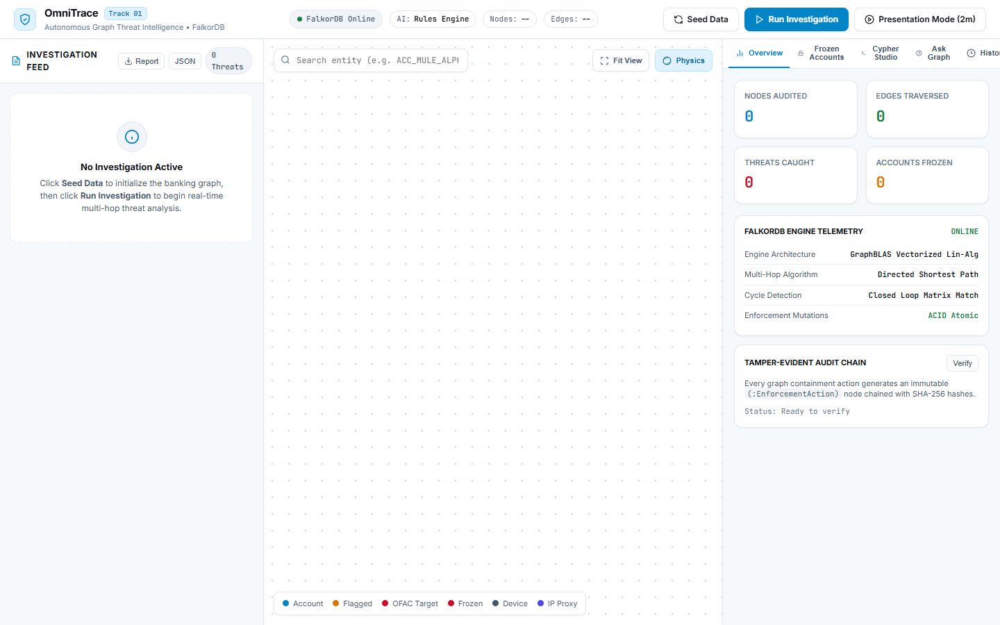
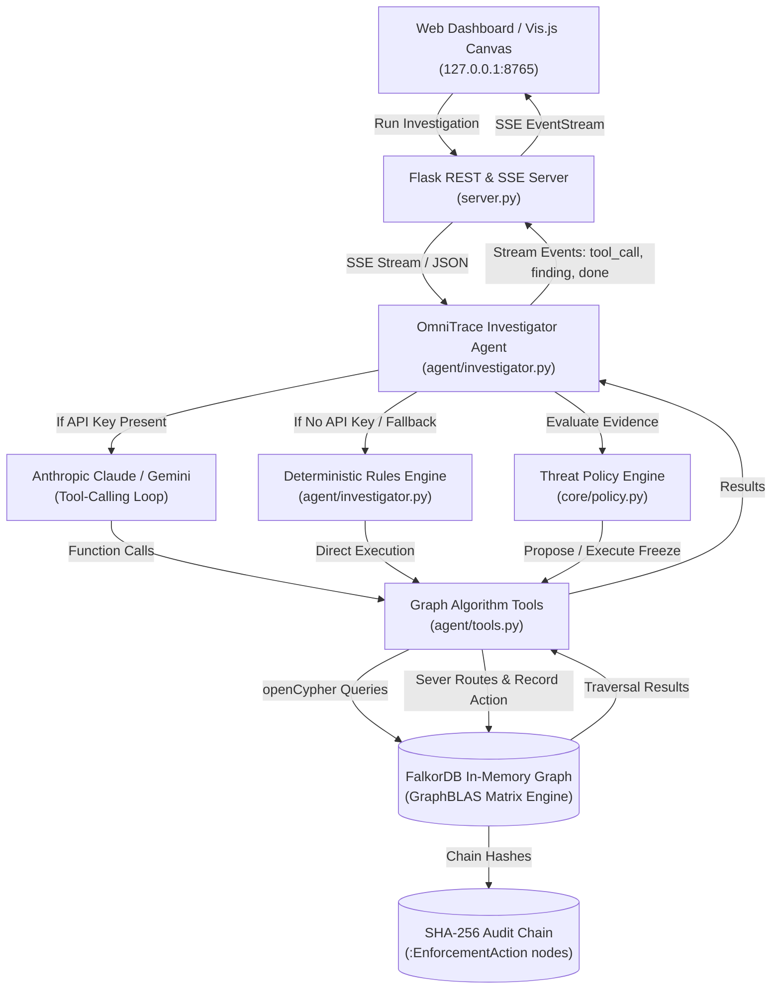
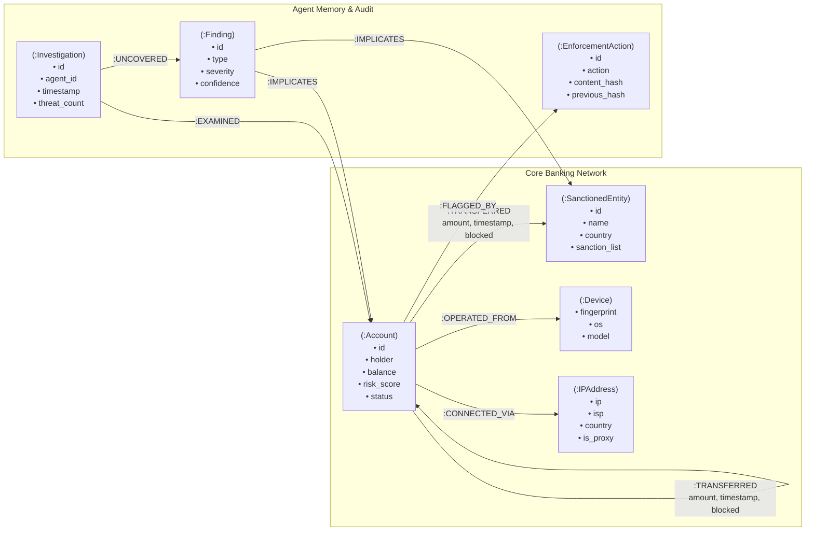

# 🛡️ OmniTrace

**Autonomous Multi-Hop Graph Fraud Investigator & Real-Time Containment Cockpit**

[](https://www.python.org/)
[](https://flask.palletsprojects.com/)
[](https://www.falkordb.com/)
[](LICENSE)

*Built for FalkorDB Graph Hacks (Track 01: Agents That Act on Connected Data).*



---

## Table of Contents

1. [Overview](#overview)
2. [Key Features](#key-features)
3. [How It Works](#how-it-works)
4. [Graph Data Model](#graph-data-model)
5. [Cypher Queries & Graph Algorithms](#cypher-queries--graph-algorithms)
6. [Detection Scenarios & Evidence](#detection-scenarios--evidence)
7. [Getting Started](#getting-started)
   - [Prerequisites](#prerequisites)
   - [Installation](#installation)
   - [FalkorDB Setup (Docker or Cloud)](#falkordb-setup)
   - [Environment Configuration](#environment-configuration)
   - [Running the Application](#running-the-application)
   - [Running Tests](#running-tests)
8. [API Reference](#api-reference)
9. [Project Structure](#project-structure)
10. [Security Architecture](#security-architecture)
11. [Data Disclosure](#data-disclosure)
12. [AI Usage Disclosure](#ai-usage-disclosure)
13. [Limitations](#limitations)
14. [Roadmap](#roadmap)
15. [License & Acknowledgements](#license--acknowledgements)

---

## Overview

Financial crime rarely presents itself as an isolated transaction; money launderers disperse funds across intermediary mules, execute circular structuring cycles to disguise ownership, and operate coordinated Sybil farms across shared hardware. Traditional relational databases struggle to uncover these deep trails, requiring expensive recursive joins that degrade as traversal depth increases.

**OmniTrace** is an autonomous graph intelligence agent built directly on FalkorDB. Rather than pulling tables into an LLM context, OmniTrace equips an AI agent with native openCypher tools to traverse multi-hop paths, uncover circular cycles, and isolate hardware clusters. The agent acts directly on connected data by severing compromised payment routes (`blocked = true`) and recording every containment action in a tamper-evident SHA-256 audit chain.

---

## Key Features

- **Autonomous Multi-Hop Reasoning**: Discovers suspicious accounts dynamically and audits multi-hop transaction trails up to 6 hops to blacklisted entities.
- **Dual Agent Modes**:
  - **AI Agent Mode**: LLM tool-calling loop using Claude (Anthropic SDK) or Gemini to plan investigation steps, call graph algorithms, and synthesize findings.
  - **Deterministic Rules Mode**: 100% offline rule-based traversal engine that executes identical discovery tools without requiring an LLM API key.
- **Direct Graph Containment**: Intervenes directly on the graph by updating account statuses to `FROZEN` and flagging outbound edges as `blocked = true`.
- **Tamper-Evident Audit Chain**: Chains every containment decision into an immutable SHA-256 antecedent hash chain of `(:EnforcementAction)` nodes verified on demand.
- **Real-Time SSE Telemetry**: Streams thinking tokens, tool executions, latencies, and findings to the UI via Server-Sent Events (`/api/investigate/stream`).
- **GraphRAG Natural Language Console**: Translates plain-English questions into read-only openCypher queries validated against live schema introspection.
- **Read-Only Cypher Studio**: Built-in query editor with pre-tuned threat queries and an AST guard that blocks write mutations (`CREATE`, `MERGE`, `SET`, `DELETE`).
- **Zero-Dependency Frontend**: Pure HTML5, CSS3, and vanilla JS with locally vendored Vis.js; operates completely offline with zero npm build step.

---

## How It Works



### Agent Execution Modes

1. **LLM Tool-Calling Mode (`AGENT_MODE=llm`)**:
   - Uses the Anthropic Python SDK (`claude-sonnet-5-5`) or Google GenAI SDK.
   - Operates a bounded loop (capped at 12 steps).
   - The LLM reasons over graph feedback, chooses which tools to call with arguments, and explains findings.
   - If an API key is missing or fails due to network/rate limits, the system falls back to rules mode without crashing and reports the error in the thinking trace.

2. **Rules Mode (`AGENT_MODE=rules` or fallback)**:
   - Requires zero external API keys and runs 100% locally.
   - Dynamically calls `list_high_risk_accounts(threshold=40)` to discover starting points without hardcoded entity IDs.
   - Traverses shortest paths to sanctions, queries cycle detection, and runs device/IP collision algorithms in sequence.

---

## Graph Data Model

The graph data model captures banking accounts, transactions, hardware devices, network proxies, agent investigation memory, and audit records.



### Node Labels

| Label | Key Properties | Code Source | Purpose |
| :--- | :--- | :--- | :--- |
| `:Account` | `id`, `holder`, `balance`, `risk_score`, `status`, `previous_risk_score` | `data/fraud_generator.py` | Bank accounts. Status is `'ACTIVE'` or `'FROZEN'`. |
| `:SanctionedEntity` | `id`, `name`, `country`, `risk_level`, `sanction_list` | `data/fraud_generator.py` | Watchlisted entities (e.g. OFAC SDN list). |
| `:Device` | `fingerprint`, `os`, `model` | `data/fraud_generator.py` | Hardware device fingerprints. |
| `:IPAddress` | `ip`, `isp`, `country`, `is_proxy` | `data/fraud_generator.py` | IP addresses and VPN proxy exit nodes. |
| `:Investigation` | `id`, `agent_id`, `timestamp`, `threat_count`, `agent_mode` | `core/falkor_graph.py` | Persistent agent graph memory recording each audit pass. |
| `:Finding` | `id`, `type`, `severity`, `confidence`, `reasoning` | `core/falkor_graph.py` | Specific threat pattern uncovered during an investigation. |
| `:EnforcementAction`| `id`, `action`, `reason`, `executed_by`, `timestamp`, `content_hash`, `previous_hash` | `core/falkor_graph.py` | Tamper-evident ledger node representing a freeze or unfreeze. |

### Relationship Types

| Relationship | Source $\to$ Target | Properties | Purpose |
| :--- | :--- | :--- | :--- |
| `:TRANSFERRED` | `(:Account) -> (:Account)`<br>`(:Account) -> (:SanctionedEntity)` | `amount`, `timestamp`, `blocked`, `blocked_at`, `unblocked_at` | Money transfers. Outbound routes are severed (`blocked = true`) upon freeze. |
| `:OPERATED_FROM` | `(:Account) -> (:Device)` | None | Links an account to hardware used for authentication. |
| `:CONNECTED_VIA` | `(:Account) -> (:IPAddress)` | None | Links an account to the IP/proxy address used for sessions. |
| `:FLAGGED_BY` | `(:Account) -> (:EnforcementAction)` | None | Cryptographic link associating accounts with audit records. |
| `:EXAMINED` | `(:Investigation) -> (:Account)` | None | Connects an investigation run to audited accounts. |
| `:UNCOVERED` | `(:Investigation) -> (:Finding)` | None | Connects an investigation run to threats produced. |
| `:IMPLICATES` | `(:Finding) -> (:Account)` | None | Links evidence to implicated accounts. |

---

## Cypher Queries & Graph Algorithms

Every query below is extracted directly from [`core/falkor_graph.py`](core/falkor_graph.py) and [`agent/tools.py`](agent/tools.py):

### 1. Directed Shortest Path to Sanctions
- **Location**: `core/falkor_graph.py::find_shortest_path_to_sanctioned`
- **Purpose**: Calculates the shortest directed path from an account to blacklisted targets.
```cypher
MATCH (src:Account {id: $account_id}), (target:SanctionedEntity)
RETURN shortestPath((src)-[:TRANSFERRED*1..6]->(target)) AS p
LIMIT 1
```

### 2. Closed-Loop Circular Structuring Rings
- **Location**: `core/falkor_graph.py::detect_circular_money_flows`
- **Purpose**: Finds 3-hop circular transaction loops with canonical ordering to eliminate rotation duplicates.
```cypher
MATCH (a:Account)-[r1:TRANSFERRED]->(b:Account)-[r2:TRANSFERRED]->(c:Account)-[r3:TRANSFERRED]->(a:Account)
WHERE a.id < b.id AND a.id < c.id AND b.id <> c.id
RETURN a.id, b.id, c.id, r1.amount, r2.amount, r3.amount
LIMIT 25
```

### 3. Sybil Hardware Fingerprint Collisions
- **Location**: `core/falkor_graph.py::detect_device_ip_sharing`
- **Purpose**: Groups accounts authenticating from the identical physical hardware device.
```cypher
MATCH (a:Account)-[:OPERATED_FROM]->(d:Device)
WITH d, collect(a.id) AS members, count(a) AS member_count
WHERE member_count >= 2
RETURN 'DEVICE' AS cluster_type, d.fingerprint AS identifier, d.model AS details, member_count, members
```

### 4. Sybil VPN / Proxy IP Collisions
- **Location**: `core/falkor_graph.py::detect_device_ip_sharing`
- **Purpose**: Identifies accounts operating from the same bulletproof proxy IP.
```cypher
MATCH (a:Account)-[:CONNECTED_VIA]->(ip:IPAddress)
WITH ip, collect(a.id) AS members, count(a) AS member_count
WHERE member_count >= 2
RETURN 'IP' AS cluster_type, ip.ip AS identifier, ip.isp AS details, member_count, members
```

### 5. High-Volume Mule In/Out Fan-Out
- **Location**: `core/falkor_graph.py::calculate_high_volume_mules`
- **Purpose**: Uncovers transit mule accounts exhibiting rapid deposit absorption and distribution.
```cypher
MATCH (a:Account)
OPTIONAL MATCH (in_acc:Account)-[r_in:TRANSFERRED]->(a)
OPTIONAL MATCH (a)-[r_out:TRANSFERRED]->(out_acc:Account)
WITH a, count(DISTINCT in_acc) AS incoming_nodes,
     count(DISTINCT out_acc) AS outgoing_nodes,
     sum(r_in.amount) AS total_in,
     sum(r_out.amount) AS total_out
WHERE incoming_nodes >= 2 AND outgoing_nodes >= 2
RETURN a.id, a.holder, a.status, incoming_nodes, outgoing_nodes, total_in, total_out
ORDER BY (incoming_nodes + outgoing_nodes) DESC
LIMIT 10
```

### 6. FalkorDB GraphBLAS PageRank Centrality
- **Location**: `core/falkor_graph.py::calculate_pagerank`
- **Purpose**: Measures PageRank transaction centrality over the transfer network using FalkorDB's linear-algebra engine.
```cypher
CALL algo.pageRank('Account', 'TRANSFERRED') YIELD node, score
RETURN node.id, score, node.status, node.risk_score
ORDER BY score DESC
LIMIT $limit
```

### 7. FalkorDB GraphBLAS Weakly Connected Components
- **Location**: `core/falkor_graph.py::detect_wcc`
- **Purpose**: Isolates disconnected subgraphs and Sybil components using GraphBLAS WCC.
```cypher
CALL algo.wcc() YIELD node, componentId
RETURN node.id, componentId, labels(node)[0] AS node_type
LIMIT 50
```

### 8. Outbound Route Severing & Account Freeze
- **Location**: `core/falkor_graph.py::freeze_account`
- **Purpose**: Mutates account state to `FROZEN`, resets risk score to 99, and marks all outbound routes as blocked.
```cypher
MATCH (a:Account {id: $account_id})
SET a.previous_risk_score = coalesce(a.risk_score, 50),
    a.status = 'FROZEN',
    a.risk_score = 99,
    a.frozen_at = $ts
WITH a
OPTIONAL MATCH (a)-[r:TRANSFERRED]->()
SET r.blocked = true,
    r.blocked_at = $ts
RETURN count(r)
```

### 9. Tamper-Evident SHA-256 Audit Blockchain
- **Location**: `core/falkor_graph.py::freeze_account` & `verify_audit_chain`
- **Purpose**: Chains containment records to antecedent hashes; enables verification of log integrity.
```cypher
MATCH (a:Account {id: $account_id})
CREATE (e:EnforcementAction {
    id: $enf_id,
    action: 'FREEZE_ACCOUNT',
    reason: $reason,
    executed_by: $agent_id,
    timestamp: $ts,
    previous_hash: $prev_hash,
    content_hash: $content_hash
})
CREATE (a)-[:FLAGGED_BY]->(e)
RETURN e.id, e.content_hash
```

---

## Detection Scenarios & Evidence

The synthetic dataset generated by [`data/fraud_generator.py`](data/fraud_generator.py) seeds three concrete fraud patterns along with legitimate decoy behaviors:

### Scenario 1: Multi-Hop Sanctions Evasion Smurfing
- **Pattern**: Compromised corporate victim routes funds across layering mules into an OFAC SDN cashout gateway.
- **Evidence Produced**:
  ```
  Trail: ACC_MULE_ALPHA -> ACC_MULE_BETA -> ACC_PANAMA_SHELL -> SANCTION_HYDRA_EXCHANGE
  Hop Count: 3 hops (Chronological transfer sequence confirmed)
  Recommended Action: FREEZE intermediary mules; FLAG_VICTIM on fund originator.
  ```

### Scenario 2: Circular Structuring Rings (Layering Loops)
- **Pattern**: A closed transaction loop cycling funds across 3 shell accounts to manufacture fake volume while preserving balance.
- **Evidence Produced**:
  ```
  Loop: ACC_RING_A -> ACC_RING_B -> ACC_RING_C -> ACC_RING_A
  Amounts: $50,000 -> $49,500 -> $49,000 -> $50,000
  Recommended Action: FREEZE all accounts in structuring ring.
  ```

### Scenario 3: Sybil Hardware & Proxy Mule Farm
- **Pattern**: Coordinated mule accounts authenticating on the identical rooted device fingerprint and bulletproof VPN IP.
- **Evidence Produced**:
  ```
  Hardware Fingerprint: DEV_HWID_8849F0 (Android 14 Rooted)
  IP Proxy: 198.51.100.42 (Bulletproof VPN Hosting)
  Accounts Implicated: ACC_FARM_MULE_01, ACC_FARM_MULE_02, ACC_FARM_MULE_03
  Recommended Action: FREEZE all colliding accounts.
  ```
- **Decoy Protection**: Legitimate branch kiosk tablets (`DEV_KIOSK_BRANCH_07`) shared by regular retail customers are evaluated by `core/policy.py` and flagged for review rather than automatically frozen.

---

## Getting Started

### Prerequisites

- **Python**: 3.10, 3.11, or 3.12
- **Docker**: For running FalkorDB locally (or access to a FalkorDB Cloud instance)

### Installation

```bash
# 1. Clone repository
git clone https://github.com/<your-username>/OmniTrace.git
cd OmniTrace

# 2. Create and activate virtual environment
python -m venv venv
# On Linux/macOS:
source venv/bin/activate
# On Windows:
.\venv\Scripts\activate

# 3. Install dependencies
pip install -r requirements.txt
```

### FalkorDB Setup

**Option A: Local Docker (Recommended)**
```bash
docker run -p 6379:6379 -p 3000:3000 -it --rm -v ./data:/var/lib/falkordb/data falkordb/falkordb:latest
```

**Option B: FalkorDB Cloud**
Sign up at [FalkorDB Cloud](https://app.falkordb.cloud/), create an instance, and note the host, port, and password.

### Environment Configuration

Copy the example environment configuration:
```bash
cp .env.example .env
```

| Variable | Description | Default |
| :--- | :--- | :--- |
| `FALKORDB_HOST` | Hostname of FalkorDB instance | `localhost` |
| `FALKORDB_PORT` | Port of FalkorDB instance | `6379` |
| `FALKORDB_USERNAME` | Username for FalkorDB authentication (optional) | *Empty* |
| `FALKORDB_PASSWORD` | Password for FalkorDB authentication (optional) | *Empty* |
| `FALKORDB_SSL` | Enable SSL/TLS for FalkorDB connection | `false` |
| `FALKORDB_GRAPH` | Target graph database name | `omnitrace_fraud_mesh` |
| `HOST` | Server bind IP address | `127.0.0.1` |
| `PORT` | Server HTTP port | `8765` |
| `ALLOWED_ORIGINS` | Comma-separated CORS allowed origins | `http://127.0.0.1:8765,http://localhost:8765` |
| `AGENT_MODE` | Agent operating mode (`rules` or `llm`) | `rules` |
| `LLM_PROVIDER` | LLM vendor when `AGENT_MODE=llm` (`anthropic` or `gemini`) | `anthropic` |
| `ANTHROPIC_API_KEY` | Anthropic API key for Claude tool calling | *Optional* |
| `LLM_MODEL` | Anthropic or Gemini model identifier | `claude-sonnet-5-5` |
| `GEMINI_API_KEY` | Google Gemini API key | *Optional* |
| `AUTO_FREEZE` | Automatically execute freezes without human-in-the-loop review | `false` |
| `OMNITRACE_API_KEY` | Secret token required in `X-API-Key` header for mutations | *Optional* |

### Running the Application

```bash
# 1. Start the Flask server
python server.py

# 2. In another terminal, seed the synthetic graph
curl -X POST http://127.0.0.1:8765/api/seed -H "Content-Type: application/json" -d '{"confirm": true}'

# 3. Open the Threat Cockpit in your browser
http://127.0.0.1:8765
```

Alternatively, run the standalone CLI demo:
```bash
python demo.py
```

### Running Tests

The test suite runs hermetically without requiring a live FalkorDB instance or LLM connection:
```bash
pytest -v
```
*Expected: 37 tests passing in ~3-4 seconds.*

---

## API Reference

Every endpoint below is defined and implemented in [`server.py`](server.py):

| Method | Path | Description | Protected by `X-API-Key`? |
| :--- | :--- | :--- | :---: |
| `GET` | `/` | Serves the web cockpit dashboard (`static/index.html`) | No |
| `GET` | `/api/health` | Health status, FalkorDB connection, node count, agent mode | No |
| `GET` | `/api/graph/state` | Returns nodes and edges topology formatted for Vis.js | No |
| `POST` | `/api/seed` | Seeds synthetic financial graph (requires `{"confirm": true}`) | Yes (if configured) |
| `POST` | `/api/investigate` | Triggers full agent investigation and returns final JSON dossier | Yes (if configured) |
| `GET/POST`| `/api/investigate/stream` | Server-Sent Events (SSE) live investigation telemetry stream | No |
| `POST` | `/api/freeze` | Direct account freeze, edges severing, and audit logging | Yes (if configured) |
| `POST` | `/api/actions/approve` | Approves proposed containment actions from investigation | Yes (if configured) |
| `POST` | `/api/actions/reject` | Rejects proposed containment action with reason | Yes (if configured) |
| `POST` | `/api/account/unfreeze` | Restores account to ACTIVE and unblocks outbound routes | Yes (if configured) |
| `GET` | `/api/audit/verify` | Validates SHA-256 antecedent hash chain of all enforcement actions | No |
| `POST` | `/api/graph/ask` | Natural language GraphRAG endpoint (synthesizes openCypher query) | No |
| `GET` | `/api/graph/schema` | Introspects node labels, relationship types, and property keys | No |
| `POST` | `/api/graph/query` | Read-only openCypher query console (`GRAPH.RO_QUERY` + mutation blocklist) | No |
| `GET` | `/api/dossiers` | Lists persisted investigation dossiers from disk | No |
| `GET` | `/api/dossiers/<id>` | Retrieves specific dossier JSON or printable compliance report (`?format=html`) | No |
| `GET` | `/api/investigations/history` | Recalls past investigations stored in FalkorDB graph memory | No |

---

## Project Structure

```
OmniTrace/
├── .env.example              # Template environment variables with placeholders
├── .gitignore                # Git ignore rules for secrets, caches, and dossiers
├── Dockerfile                # Production container specification for Flask server
├── LICENSE                   # MIT License
├── README.md                 # Project documentation
├── docker-compose.yml        # Docker compose orchestrating FalkorDB + OmniTrace
├── pytest.ini                # Pytest configuration
├── requirements.txt          # Python runtime dependencies
├── demo.py                   # Standalone end-to-end CLI demonstration
├── server.py                 # Flask web server, SSE streaming, and REST API
├── agent/                    # Autonomous investigator agent logic
│   ├── __init__.py
│   ├── graph_rag.py          # Schema-introspected Natural Language GraphRAG
│   ├── investigator.py       # Dual-mode agent (Anthropic tool calling + rules fallback)
│   └── tools.py              # openCypher investigation tools conforming to function call specs
├── benchmarks/               # Performance measurement scripts
│   ├── __init__.py
│   └── multihop.py           # FalkorDB shortestPath vs SQLite recursive CTE benchmark
├── core/                     # Graph engine wrapper and containment policy
│   ├── __init__.py
│   ├── falkor_graph.py       # FalkorDB client wrapper, algorithms, and audit chain
│   └── policy.py             # Deterministic threat scoring and false-positive guards
├── data/                     # Synthetic financial fraud data generator
│   ├── __init__.py
│   └── fraud_generator.py    # Synthetic topology generator (smurfing, cycles, Sybils)
├── docs/                     # Documentation assets and screenshots
│   └── screenshot.png        # Cockpit dashboard interface screenshot
├── static/                   # Frontend assets (no build step required)
│   ├── app.js                # Cockpit controller, Vis.js graph manager, and SSE receiver
│   ├── index.html            # Single-page enterprise light-theme dashboard
│   ├── styles.css            # Enterprise light-theme design system
│   └── vendor/               # Locally vendored libraries for offline execution
│       └── vis-network.min.js
└── tests/                    # Pytest test suite (37 tests, runs hermetically)
    ├── test_live_agent_stream.py
    ├── test_phase1_agent.py
    ├── test_phase2_graph.py
    ├── test_phase3_safety.py
    ├── test_phase4_5_6_7.py
    ├── test_phase4_reliability.py
    └── test_phase5_realism.py
```

---

## Security Architecture

1. **Read-Only Query Console**:
   The `/api/graph/query` endpoint executes queries via `graph.ro_query()` and enforces an AST regex blocklist against mutation keywords (`CREATE`, `MERGE`, `SET`, `DELETE`, `REMOVE`, `DROP`). Queries exceeding 1000 rows are safely truncated.
2. **API Key Authentication**:
   When `OMNITRACE_API_KEY` is configured in the environment, all mutating endpoints (`/api/seed`, `/api/freeze`, `/api/actions/approve`, `/api/actions/reject`, `/api/account/unfreeze`, `/api/investigate`) require the `X-API-Key` HTTP header. Missing or invalid keys return HTTP 401. If unset, a security warning is logged.
3. **Destructive Action Confirmation**:
   The `/api/seed` endpoint clears and repopulates the graph; it strictly requires `{"confirm": true}` in the JSON body.
4. **CORS Lockdown & Localhost Binding**:
   By default, the server binds to `127.0.0.1` and restricts CORS origins to `http://127.0.0.1:8765` and `http://localhost:8765`.
5. **No Secret Commits**:
   Local `.env` files are git-ignored. Code references environment variables through standard lookups.

> [!WARNING]
> Do NOT expose OmniTrace directly to the public internet without putting it behind a reverse proxy (e.g. Nginx, Caddy) with TLS termination, rate limiting, and an authentication gateway.

---

## Data Disclosure

All data used in OmniTrace is **100% synthetic** and programmatically generated by [`data/fraud_generator.py`](data/fraud_generator.py). No real customer names, real banking account numbers, real Social Security Numbers, or real transaction feeds are used.

---

## AI Usage Disclosure

In compliance with hackathon submission guidelines:
- **Development Assistance**: AI coding assistants (Google Antigravity and Anthropic Claude) were used during development for scaffolding, test generation, and frontend styling.
- **Human Verification**: All code, Cypher queries, graph algorithm calls, and security guards were reviewed, verified, and debugged by the human author.
- **Runtime LLM Tool Calling**: When configured in `llm` mode, the agent sends graph summary schemas and tool arguments to Claude (`claude-sonnet-5-5`) or Gemini. Because all graph data is synthetic, no real PII is transmitted. When in `rules` mode, zero data leaves the local machine.

---

## Limitations

- **Prototype on Synthetic Data**: OmniTrace is a hackathon prototype designed to demonstrate agents acting on connected data in FalkorDB; it is not a production banking platform.
- **No Live Financial Rail Ingestion**: It operates on an in-memory graph snapshot and does not connect to live banking networks (e.g. SWIFT, Fedwire, ACH).
- **Single Instance**: Designed for single-instance FalkorDB deployments; multi-region cluster replication is left to FalkorDB enterprise infrastructure.
- **Production Compliance Requirements**: A real-world deployment would require integration with core banking transactional CDC streams, formal KYC identity verification, and compliance analyst workflows.

---

## Roadmap

- [x] Multi-hop shortest path analysis to sanctions watchlists
- [x] Matrix-matched circular structuring loop detection
- [x] Sybil device and VPN proxy collision clustering
- [x] Direct graph containment (outbound route severing via `blocked = true`)
- [x] Tamper-evident SHA-256 chained audit trail (`(:EnforcementAction)`)
- [x] Human-in-the-loop action approval and rejection
- [x] Server-Sent Events (SSE) live investigation telemetry stream
- [x] Natural language GraphRAG console with live schema introspection
- [x] GraphBLAS PageRank and Weakly Connected Components integration
- [x] Enterprise light-theme visual dashboard (zero npm build, offline vendored Vis.js)
- [x] Hermetic test suite with 37 tests passing without database or LLM requirements
- [ ] Integration with Apache Kafka / Debezium for real-time transaction CDC ingestion
- [ ] Automated generation of FinCEN Suspicious Activity Reports (SAR XML / PDF)

---

## License & Acknowledgements

- **OmniTrace** is open-source software licensed under the [MIT License](LICENSE).
- **FalkorDB** is developed by FalkorDB Ltd and licensed under the Server Side Public License (SSPLv1).
- **vis-network** is maintained by the VisJS community and licensed under the MIT / Apache 2.0 License.
