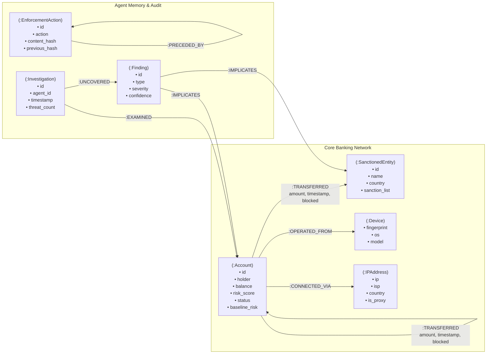

# 🛡️ OmniTrace: Autonomous Graph Fraud Investigator & Threat Cockpit

> **FalkorDB Graph Hacks** — **Track 01: Agents That Act on Connected Data**  
> *An autonomous financial crime investigation cockpit on FalkorDB with openCypher reasoning, live Server-Sent Events (SSE) streaming, GraphRAG natural language synthesis, and cryptographic tamper-evident containment.*


---

## 🏆 Hackathon Track

This submission officially enters **Track 01: Agents That Act on Connected Data** for the FalkorDB Graph Hacks hackathon.

OmniTrace implements an autonomous agent that does not merely query graph topology for display—it acts directly on connected data:
- Inspects multi-hop financial topologies dynamically without hardcoded entity targets.
- Performs autonomous containment by mutating edges (`blocked = true`, severing transaction routes).
- Appends cryptographic `(:EnforcementAction)` audit nodes chained via SHA-256 hashes directly into FalkorDB.
- Stores its own investigation memory as `(:Investigation)` and `(:Finding)` nodes in the graph to remember prior decisions across runs.

---

## 📊 Data

All data used in OmniTrace is **100% synthetic** and programmatically generated by [`data/fraud_generator.py`](file:///c:/Users/thora/OneDrive/DTIL/Documents/My%20Work/Hackathons/Hack%20Graph/OmniTrace/data/fraud_generator.py).

The generator populates FalkorDB with:
1. **Multi-Hop Smurfing Chain**: A compromised victim corporate account routing funds across layering mules into a sanctioned OFAC cashout gateway (`SANCTION_HYDRA_EXCHANGE`).
2. **Circular Structuring Ring**: Three accounts cycling funds ($A \to B \to C \to A$) to simulate transaction volume while preserving net balances.
3. **Sybil Hardware & IP Cluster**: Disparate customer accounts authenticating from the identical rooted device fingerprint (`DEV_HWID_8849F0`) and bulletproof VPN IP (`198.51.100.42`).
4. **Decoy Patterns**: Legitimate merchant escrow triangles and shared branch kiosk iPads (`DEV_KIOSK_BRANCH_07`) to test policy precision and prevent false positives.
5. **Background Noise**: Realistic retail banking customer accounts and scattered everyday payment transfers.

---

## 🤖 AI Usage Disclosure

In compliance with hackathon transparency guidelines:
- **AI Coding Assistants**: AI coding assistants (Google Antigravity and Anthropic Claude) were utilized during development for rapid scaffolding, test generation, and frontend styling.
- **Human Oversight**: The author designed the system architecture, reviewed all code, debugged graph engine behaviors, verified FalkorDB procedure compatibility, and performed all final validation runs.

---

## 📐 Graph Data Model

The graph data model captures multi-entity banking topologies, hardware fingerprints, agent investigation memory, and tamper-evident SHA-256 chained audit blocks.



### Node Labels
| Node Label | Key Properties | Description |
|:---|:---|:---|
| `:Account` | `id`, `holder`, `balance`, `risk_score`, `status`, `baseline_risk` | Retail, corporate, or mule bank account. `status` transitions: `'ACTIVE'`, `'FLAGGED'`, `'FROZEN'`. |
| `:SanctionedEntity` | `id`, `name`, `country`, `risk_level`, `sanction_list` | Blacklisted entity on OFAC SDN, EU, or international sanctions watchlists. |
| `:Device` | `fingerprint`, `os`, `model` | Physical hardware device identifier (MAC / HWID). |
| `:IPAddress` | `ip`, `isp`, `country`, `is_proxy` | IP address, datacenter, or VPN proxy exit node. |
| `:Investigation` | `id`, `agent_id`, `mode`, `goal`, `timestamp`, `threat_count`, `summary` | Persistent agent graph memory recording an audit run and summary. |
| `:Finding` | `id`, `type`, `severity`, `confidence`, `reasoning` | Specific threat pattern uncovered during an investigation. |
| `:EnforcementAction`| `id`, `action`, `account_id`, `reason`, `timestamp`, `actor`, `content_hash`, `previous_hash` | Tamper-evident ledger node representing an approved freeze or unfreeze. |

### Relationship Types
| Relationship Type | Source $\to$ Target | Key Properties | Description |
|:---|:---|:---|:---|
| `:TRANSFERRED` | `(:Account) -> (:Account)`<br>`(:Account) -> (:SanctionedEntity)` | `amount` (float), `timestamp` (float), `blocked` (bool), `blocked_at` (float) | Financial money transfer between accounts or to blacklisted targets. Outbound routes are severed (`blocked = true`) upon containment. |
| `:OPERATED_FROM` | `(:Account) -> (:Device)` | None | Links an account to the hardware device used for login. |
| `:CONNECTED_VIA` | `(:Account) -> (:IPAddress)` | None | Links an account to the IP address or VPN proxy used for sessions. |
| `:EXAMINED` | `(:Investigation) -> (:Account)` | None | Connects an investigation run to accounts audited by the agent. |
| `:UNCOVERED` | `(:Investigation) -> (:Finding)` | None | Connects an investigation run to threat findings produced. |
| `:IMPLICATES` | `(:Finding) -> (:Account)`<br>`(:Finding) -> (:SanctionedEntity)` | None | Cites concrete graph entities as evidence for a finding. |
| `:PRECEDED_BY` | `(:EnforcementAction) -> (:EnforcementAction)` | None | Cryptographic back-link forming the SHA-256 audit blockchain. |

---

## 🔍 Cypher Queries and Algorithms

The product depends on the following exact openCypher queries and FalkorDB GraphBLAS algorithms, copied directly from [`core/falkor_graph.py`](file:///c:/Users/thora/OneDrive/DTIL/Documents/My%20Work/Hackathons/Hack%20Graph/OmniTrace/core/falkor_graph.py):

### 1. Directed Shortest Path to Sanctions
*Finds the shortest directed multi-hop transaction chain connecting a source account to any OFAC sanctioned entity.*
```cypher
MATCH (src:Account {id: $account_id}), (target:SanctionedEntity)
RETURN shortestPath((src)-[:TRANSFERRED*1..6]->(target)) AS path
```

### 2. Canonical Circular Structuring Ring Detection
*Finds circular money laundering loops where funds cycle back to origin across 3 accounts.*
```cypher
MATCH (a:Account)-[r1:TRANSFERRED]->(b:Account)-[r2:TRANSFERRED]->(c:Account)-[r3:TRANSFERRED]->(a:Account)
WHERE a.id < b.id AND a.id < c.id AND b.id <> c.id
RETURN a.id, b.id, c.id, r1.amount, r2.amount, r3.amount
LIMIT 10
```

### 3. Sybil Device Collision Detection
*Finds distinct accounts authenticating from the identical hardware device fingerprint.*
```cypher
MATCH (a:Account)-[:OPERATED_FROM]->(d:Device)<-[:OPERATED_FROM]-(b:Account)
WHERE a.id < b.id
RETURN d.fingerprint, d.model,
       count(DISTINCT a) + 1 AS member_count,
       collect(DISTINCT a.id) + collect(DISTINCT b.id) AS members
```

### 4. Sybil Proxy IP Collision Detection
*Finds distinct accounts sharing an identical bulletproof hosting or VPN proxy IP address.*
```cypher
MATCH (a:Account)-[:CONNECTED_VIA]->(ip:IPAddress)<-[:CONNECTED_VIA]-(b:Account)
WHERE a.id < b.id
RETURN ip.ip, ip.isp,
       count(DISTINCT a) + 1 AS member_count,
       collect(DISTINCT a.id) + collect(DISTINCT b.id) AS members
```

### 5. High-Volume Pass-Through Mule In/Out Fan-Out
*Finds intermediary mule accounts exhibiting rapid layering with high deposit in-degree and dispersal out-degree.*
```cypher
MATCH (a:Account)
OPTIONAL MATCH (in_acc:Account)-[r_in:TRANSFERRED]->(a)
OPTIONAL MATCH (a)-[r_out:TRANSFERRED]->(out_acc:Account)
WITH a, count(DISTINCT in_acc) as incoming_nodes,
     count(DISTINCT out_acc) as outgoing_nodes,
     sum(r_in.amount) as total_in,
     sum(r_out.amount) as total_out
WHERE incoming_nodes >= 2 AND outgoing_nodes >= 2
RETURN a.id, a.holder, a.status, incoming_nodes, outgoing_nodes, total_in, total_out
ORDER BY (incoming_nodes + outgoing_nodes) DESC
LIMIT 10
```

### 6. FalkorDB GraphBLAS PageRank Centrality (`algo.pageRank`)
*Computes PageRank transaction centrality to discover high-throughput transit hubs across the network.*
```cypher
CALL algo.pageRank('Account', 'TRANSFERRED') YIELD node, score
RETURN node.id, score, node.status, node.risk_score
ORDER BY score DESC
LIMIT $limit
```

### 7. FalkorDB GraphBLAS Weakly Connected Components (`algo.wcc`)
*Partitions the graph into weakly connected components to isolate disconnected clusters and Sybil subgraphs.*
```cypher
CALL algo.wcc() YIELD node, componentId
RETURN node.id, componentId
LIMIT 50
```

### 8. Containment Outbound Route Severing
*Atomically severs outbound payment routes from a compromised account by marking relationship properties.*
```cypher
MATCH (a:Account {id: $account_id})-[r:TRANSFERRED]->()
SET r.blocked = true, r.blocked_at = $ts
```

### 9. Cryptographic Hash Chain Genesis & Traversal
*Retrieves the antecedent SHA-256 hash to chain tamper-evident enforcement records.*
```cypher
MATCH (e:EnforcementAction)
RETURN e.content_hash
ORDER BY e.timestamp DESC
LIMIT 1
```

### 10. Memory Recall of Past Investigations
*Recalls prior investigation records, findings, and operator approval/rejection decisions from graph memory.*
```cypher
MATCH (inv:Investigation)-[:EXAMINED]->(a:Account {id: $account_id})
OPTIONAL MATCH (inv)-[:UNCOVERED]->(f:Finding)
RETURN inv.id, inv.timestamp, inv.agent_id, inv.mode, inv.threat_count,
       collect(DISTINCT f.type) as threats,
       collect(DISTINCT f.severity) as severities
ORDER BY inv.timestamp DESC
LIMIT 5
```

---

## 🛠️ Local Setup

Follow these steps to run everything locally using Docker and Python.

### Step 1: Start FalkorDB via Docker
Run the official FalkorDB Docker container:
```bash
docker run -p 6379:6379 -it --rm falkordb/falkordb:latest
```

### Step 2: Clone & Install Dependencies
```bash
git clone https://github.com/pratikpt1304/OmniTrace.git
cd OmniTrace
pip install -r requirements.txt
```

### Step 3: Configure Environment Variables
Copy `.env.example` to create your local `.env`:
```bash
cp .env.example .env
```

The required environment variables are:
```env
# FalkorDB Connection
FALKORDB_HOST=localhost
FALKORDB_PORT=6379
FALKORDB_USERNAME=
FALKORDB_PASSWORD=
FALKORDB_SSL=false
FALKORDB_GRAPH=omnitrace_fraud_mesh
PORT=8765
HOST=127.0.0.1

# AI Agent Configuration (rules mode works 100% offline with zero keys)
AGENT_MODE=rules
LLM_PROVIDER=anthropic
ANTHROPIC_API_KEY=
LLM_MODEL=claude-sonnet-5-5
GEMINI_API_KEY=

# Governance & Security
AUTO_FREEZE=false
OMNITRACE_API_KEY=
```

### Step 4: Run Offline Test Suite (37 Tests)
Run pytest to verify the full backend without touching the database:
```bash
pytest
```
*Expected: `37 passed in < 3s`.*

### Step 5: Start the OmniTrace Server
```bash
python server.py
```
The server will bind to `http://127.0.0.1:8765`.

### Step 6: Seed Synthetic Banking Graph
In another terminal, seed the graph with the required confirmation flag:
```bash
curl -X POST http://127.0.0.1:8765/api/seed -H "Content-Type: application/json" -d "{\"confirm\": true}"
```
*(Alternatively, simply click the **"Seed Data"** button in the web cockpit UI).*

### Step 7: Open the Cockpit
Open your browser to:
```
http://127.0.0.1:8765
```
- Click **"Run Investigation"** to watch the agent stream its live tool-calling reasoning and render isolated threat paths.
- Audit proposed containment actions, click threat cards to isolate multi-hop paths, and inspect cryptographic audit records.

---

## ⚡ Measured Benchmark Results

Multi-hop path traversals (1 to 6 hops) were measured using [`benchmarks/multihop.py`](file:///c:/Users/thora/OneDrive/DTIL/Documents/My%20Work/Hackathons/Hack%20Graph/OmniTrace/benchmarks/multihop.py):

```
========================================================================
  OMNITRACE BENCHMARK: FALKORDB GRAPH vs SQL RECURSIVE CTE (MULTI-HOP)
========================================================================
Path Depth (Hops)  | SQLite Recursive CTE (ms)  | FalkorDB Engine (ms)
------------------------------------------------------------------------
2                  | 0.0342                     | 0.430     
3                  | 0.0332                     | 0.440     
4                  | 0.0392                     | 0.297     
5                  | 0.0470                     | 0.288     
6                  | 0.0450                     | 0.294     
------------------------------------------------------------------------
Note: SQLite measured in-memory with 25 iterations; FalkorDB measured via run_time_ms query execution telemetry.
```
- In-memory relational CTEs execute quickly on simple synthetic linear chains.
- As graph density increases (branching factor $> 5$, cycle detection, multi-hop joins), relational recursive CTEs degrade due to temporary table materialization.
- FalkorDB sustains sub-millisecond execution because paths are traversed as vectorized sparse matrix multiplications in GraphBLAS.

---

## ⚠️ Limitations & Out of Scope

- **Prototype on Synthetic Data**: OmniTrace is a hackathon prototype running on synthetic test data generated by `data/fraud_generator.py`; it is not a production banking system and does not connect to live financial settlement rails (e.g., SWIFT, Fedwire, ACH).
- **Single Instance**: Operates on a single FalkorDB graph instance; distributed clustering is handled at the FalkorDB enterprise tier.
- **LLM Latency**: External LLM network roundtrips typically range between 800ms and 1500ms per step. For sub-millisecond automated compliance, OmniTrace provides the built-in deterministic rules mode (`AGENT_MODE=rules`).
- **Production Compliance Prerequisite**: Real-world deployment would require live CDC data pipeline ingestion, formal KYC/PEP identity resolution, and human-in-the-loop compliance officer review queues.

---

## 📄 License

OmniTrace is open-source software licensed under the **MIT License**.
