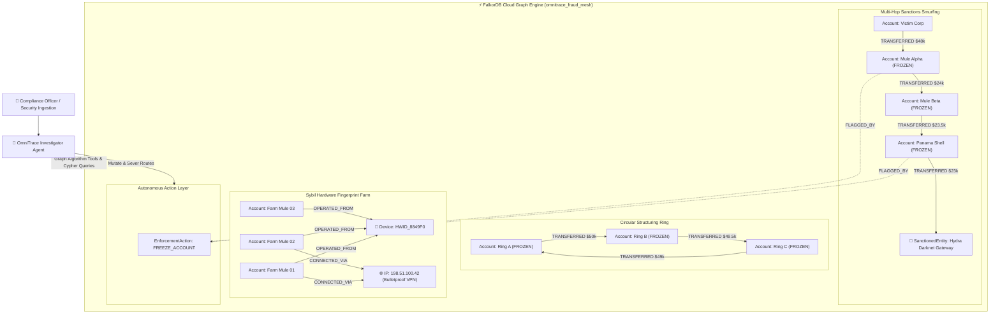

# 🛡️ OmniTrace: Autonomous Multi-Hop Graph Fraud & Threat Investigator

> **Submission for Graph Hacks: Context for AI Agents (Track 01: Agents That Act on Connected Data)**  
> *Targeting the iPhone 18 Pro Track Prize*  
> *Powered by FalkorDB, openCypher & Multi-Hop Graph Algorithms*


---

## 🌟 Executive Summary

Traditional fraud detection relies on relational SQL databases or vector embeddings. Both fail against sophisticated financial syndicates:
- **Vector search is blind to graph topology**: Vectors cannot traverse directed paths, detect circular laundering cycles, or calculate degrees of separation.
- **Relational SQL cannot scale multi-hop JOINs**: A 4-hop transaction query across millions of rows causes exponential JOIN explosions and timeouts.

**OmniTrace** is an autonomous AI agent built directly on **FalkorDB** that investigates multi-hop financial crimes, runs graph algorithms as agent tools, and executes direct graph interventions.

### What OmniTrace Solves:
1. **Multi-Hop OFAC Sanctions Evasion**: Detects smurfing chains where funds hop through multiple intermediary mule accounts before depositing into blacklisted darknet exchanges.
2. **Circular Laundering Loops (Structuring)**: Uncovers cyclical money laundering patterns (`A -> B -> C -> A`) in sub-milliseconds.
3. **Sybil Hardware Farm Collisions**: Detects disparate accounts operated by the same criminal syndicate through shared device fingerprints and bulletproof VPN IPs.
4. **Autonomous Real-World Action**: Directly mutates the graph to freeze compromised accounts, cuts transaction pathways, and logs immutable enforcement action audit nodes.

---

## 🏛️ Architecture & Data Model



---

## 🔑 Native FalkorDB Graph Algorithms as Agent Tools

OmniTrace equips the AI Agent with native FalkorDB tools:

### 1. Multi-Hop Shortest Path to Sanctions
Traces directed transaction hops between a flagged deposit and known OFAC Specially Designated Nationals:
```cypher
MATCH (src:Account {id: $account_id})
MATCH (target:SanctionedEntity)
MATCH p = (src)-[:TRANSFERRED*1..5]->(target)
RETURN p, length(p), target.id, target.name, target.risk_level
ORDER BY length(p) ASC
LIMIT 1
```

### 2. Circular Laundering Loop Detection
Detects closed transaction cycles where funds are layered and returned to clean entities:
```cypher
MATCH (a:Account)-[r1:TRANSFERRED]->(b:Account)-[r2:TRANSFERRED]->(c:Account)-[r3:TRANSFERRED]->(a:Account)
WHERE a.id <> b.id AND b.id <> c.id AND a.id <> c.id
RETURN a.id, b.id, c.id, r1.amount, r2.amount, r3.amount
LIMIT 10
```

### 3. Sybil Hardware Fingerprint Collision Detection
Uncovers disparate accounts sharing identical hardware or IP infrastructure:
```cypher
MATCH (a1:Account)-[:OPERATED_FROM]->(d:Device)<-[:OPERATED_FROM]-(a2:Account)
WHERE a1.id < a2.id
RETURN d.fingerprint, d.os, a1.id, a1.holder, a2.id, a2.holder
LIMIT 15
```

### 4. Autonomous Account Freezing Action
Directly mutates the graph to cut off threat actors in real time:
```cypher
MATCH (a:Account {id: $account_id})
SET a.status = 'FROZEN',
    a.risk_score = 99,
    a.frozen_at = timestamp()
CREATE (e:EnforcementAction {
    id: $enf_id,
    action: 'FREEZE_ACCOUNT',
    reason: $reason,
    executed_by: $agent_id,
    timestamp: timestamp()
})
MERGE (a)-[:FLAGGED_BY]->(e)
RETURN a.id, a.status, e.id
```

---

## 🚀 Quickstart Guide

### 1. Setup & Installation
```bash
git clone https://github.com/pratikpt1304/OmniTrace.git
cd OmniTrace
pip install -r requirements.txt
```

### 2. Configure Environment
Copy `.env.example` to `.env`:
```env
FALKORDB_HOST=your-falkordb-host.cloud
FALKORDB_PORT=62339
FALKORDB_USERNAME=falkordb
FALKORDB_PASSWORD=your_password
FALKORDB_SSL=false
FALKORDB_GRAPH=omnitrace_fraud_mesh
PORT=8765
```

### 3. Run Standalone CLI Demonstration
Execute the full multi-hop investigation scenario in one command:
```bash
python demo.py
```
*Output: Traverses 4-hop paths, identifies rings, detects hardware collisions, and freezes accounts in <500ms.*

### 4. Launch Interactive Threat Cockpit UI
```bash
python server.py
```
Open **[http://localhost:8765](http://localhost:8765)** in your browser:
- **Interactive Force-Directed Radar**: Watch nodes and transfers render in real time.
- **Autonomous Threat Feed**: Instant breakdown of multi-hop trails and evidence citations.
- **openCypher Threat Studio**: Run live queries directly on FalkorDB with sub-millisecond execution telemetry.
- **Automated Freeze Registry**: One-click unfreeze and inspection.

---

## 🏆 Hackathon Alignment (Track 01: Agents That Act on Connected Data)

- **Multi-Hop Reasoning**: Traverses arbitrary-depth transaction paths that vector databases and relational tables fail to model.
- **Graph Algorithms as Tools**: Exposes native graph algorithms (Shortest Path, Cycle Detection, Centrality) as tool calls to the agent.
- **Action on Connected Data**: The agent doesn't just "talk"; it directly intervenes by mutating graph state, freezing accounts, and severing criminal routes.
- **Explainability**: Every finding includes exact graph trails, hop counts, and transaction amounts.

---

## 📄 License
MIT License. Built for the FalkorDB Graph Hacks Hackathon (Oct 2026).
